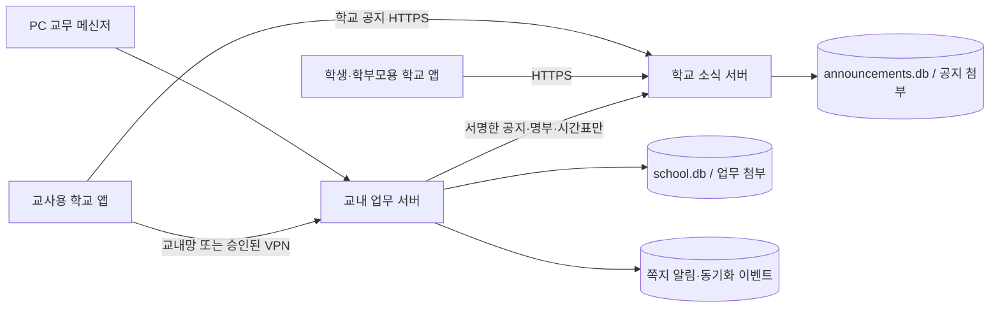

# 구조와 연결 경계

기존 ASP.NET Core/.NET 10 + SQLite 구조를 유지한다. PC는 WPF, 두 학교 앱은 MAUI Android/iOS다. 사용자용 웹앱으로 바꾸지 않는다.

좌석 IP는 위치 정보다. 계정·내부 ID·개인 비밀번호·세션으로 인증한다. 공개 서버에서 교내 서버로 임의 API를 호출하는 통로를 추가하지 않는다. 원격지원은 교내 서버가 동의와 연결 정보만 중계하고 단말끼리 TLS로 연결한다.

`SchoolMessenger.Shared/Backend`의 소스를 두 서버에만 링크한다. 프레임워크·새 DB·공통 웹앱을 도입하지 않는다. 서버 종류마다 데이터 폴더와 프로세스 잠금을 분리한다. 일반 앱 API 형식은 유지하며 서버 연결 프로토콜만 함께 교체한다.

명부 동기화에는 현재 필요한 이름·소속·관계·권한 ID가 포함된다. 이를 익명 정보라고 표현하지 않는다. 최소화 여부와 제공 목적은 학교 심의 대상이다. 사적 쪽지·쪽지 첨부·원격 화면은 이 연결로 보내지 않는다.

## 기존 브라우저 화면 의존성

정적 화면이 두 서버에 남아 있고 일부 기존 검사·고급 관리자 작업에 쓰인다. PC의 `PortalAdministrationWindow`는 학교 명부·학생 승인·고유번호·관계 해제와 이번 보호자 신청 심사를 네이티브 화면으로 처리한다. PC의 교직원 계정·시간표 관리도 유지한다. 아직 전체 관리 기능의 화면 대조와 네이티브 전환 완료를 주장하지 않는다. 기능 누락 확인 전 정적 화면을 삭제하거나 운영 호스팅을 바꾸지 않는다.

FCM/APNs 백그라운드 푸시는 아직 없다. 실시간 쪽지 큐와 앱을 열었을 때의 조회가 백그라운드 푸시를 대신한다고 설명하지 않는다.
