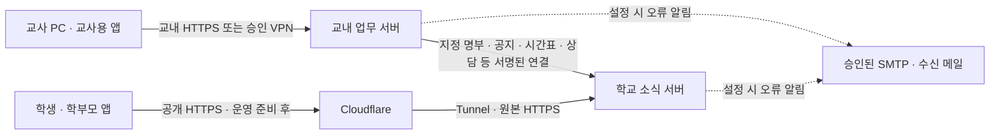

# 학운위·에듀집 검토용 보안 근거 자료

2026-10-24 · 학교 검토용 초안 · 정식 출시 전 1.0.0

이 자료는 제품 설명과 개발 검증 근거를 모은 것이다. 학운위 심의 완료, 에듀집 등록 승인, 보안 인증, 도름스 마크 발급을 의미하지 않는다. 학교·교육청의 적용 기준과 운영센터의 실제 등록 요건을 별도로 확인한다.

## 제품과 현재 준비 수준

| 제품 | 이용자·연결 | 현재 산출물 |
| --- | --- | --- |
| Windows 교무메신저 | 교직원, 교내 업무 서버 HTTPS | 설치 마법사·가상 데이터 검증. 학교 배포자 코드서명 전 |
| 교사용 교무실 앱 | 교직원, 교내망 또는 승인 VPN의 업무 서버 | 별도 Android 시험 APK, 공통 iOS 소스. 최신 실기기 검증 필요 |
| 학생·학부모용 학교 소식 앱 | 학생·학부모, 공개 학교 소식 서버 HTTPS | 별도 Android 시험 APK, 공통 iOS 소스. 스토어·정식 서명 준비 필요 |
| 서버 프로그램 | 교내 업무 역할·외부 학교 소식 역할 | 역할 선택 EXE 설치·업데이트·제거 검증. 실제 격리·운영 설정은 학교 확인 |

‘가족용 앱’이라는 별도 제품은 없다. `Family`는 내부 빌드 식별자다. 자동업데이트와 자동 공개 배포는 이번 보안 보완으로 활성화하지 않았다. 실제 학교 자료를 넣기 전 가상 계정 시운행을 진행한다.

## 데이터 흐름과 접근 경계

교내 개인 메시지·업무 첨부·채팅과 원격 화면을 학교 소식 서버로 무조건 복제하지 않는다. 공지·명부·시간표·상담·수강신청 연결은 해당 기능의 명시적 범위와 서비스 인증으로 처리한다. 원격지원은 상대 수락과 권한에 따른 PC 간 직접 통신이며 학교 서버는 화면·입력을 중계하지 않는다.

학생·학부모 앱은 인증과 현재 자녀/학급/분반 관계, 공지 대상에 따라 자료를 받는다. 다른 자녀·학급의 ID를 입력한다고 열람 권한이 생기지 않는지 가상 계정으로 시험한다. 교사 앱의 화면과 별개로 서버에서 권한을 검사한다.

Cloudflare Tunnel은 학교의 수신 포트를 새로 열지 않는 연결 방식을 제공하지만 익명화나 단말 간 종단 암호화를 보장하는 것으로 설명하지 않는다. 일반 프록시 HTTPS는 방문자↔Cloudflare와 Cloudflare↔원본 구간으로 나뉘므로, 실제 외부 사업자 처리·로그·계약·위치와 고지 필요 사항을 학교가 확인해야 한다. [Cloudflare 암호화 구간 설명](https://developers.cloudflare.com/ssl/concepts/).

## 개인정보·보유·파기 설명에 넣을 내용

| 구분 | 기능에서 처리하는 주요 정보 | 검토할 운영 내용 |
| --- | --- | --- |
| 교직원 계정 | 이름 아이디·이름·부서·직책·권한·선택 좌석 IP·비밀번호 해시·세션 | 전용 계정·개인 비밀번호·활성화·관리자 구분, 교직원 정보 보유 기준 |
| 학생·학부모 계정 | 이름·로그인 식별자·역할·학급·자녀 관계·가입/동의·고유번호 관리 | 학교가 확인한 명부·관계, 임시회원과 정회원 범위, 분실·번호 재발급 |
| 업무·학교 소식 | 메시지·첨부·공지·읽음·제출·일정·예약·수강신청 등 선택한 기능의 기록 | 실제 사용할 기능만 활성화·운영하고 대상별 권한과 보유 기간을 확정 |
| 운영·오류 | 접속 처리에 필요한 메타데이터·추적번호·오류 종류·접수 내용·선택 메일 | 프록시·OS·메일 로그와 오류 신고의 수집 최소화·접근 권한·보유 기간 |
| 백업 | 운영 DB·관리 첨부 사본·복구에 필요한 키 | 별도 장치·암호화·권한·실제 복원·파기 반영 확인 |

사용자가 정한 기준은 학생 재학 기간 보유와 졸업 시 계정·관련 정보 파기, 학부모는 마지막 재학 자녀 졸업 시 함께 탈퇴·파기다. 관련 계정·관계·세션·초대·관리 백업·교내 수신 현황 캐시의 파기와 실패 시 재시도를 합성 시험했다. 교직원 기록·본문에 임의로 적힌 개인정보·감사/오류 기록의 세부 보유 기준과 외부 사업자 기록까지 모두 자동 파기된다고 확대해서 설명하지 않는다.

첨부파일은 기존 30일 만료 기준을 유지한다. 공지 이미지도 원래 만료를 연장하지 않고 처리한다. 오류 메일은 실제 설정 시 이름·발생 시각·접수번호 등이 수신 메일로 이동하므로, 개인 Gmail 수신 방식을 학교가 승인하고 처리 안내에 반영할지 확인한다. 이번 시험은 가상 SMTP로 했고 실제 사용자 메일을 발송하지 않았다.

현재 정책 파일은 검토용 초안이며 `approvedForProduction:false`다. 운영 신규 가입은 학교가 전문과 시행 조건을 확정한 정책을 설정한 뒤 진행한다. 문의처는 **여양고등학교 교무실(061-689-5870)**이다. 별도 담당부서 이름이나 미확정 책임자를 만들어 넣지 않았다.

## 제시할 수 있는 개발 근거

- 체크리스트 대응·위험도·소스 위치·수정·미확인: [로컬 보안 점검 보고서](security-checklist-2026-10-24.md).
- 서버 로그 합성 시험: 쿼리·예외 원문 미출력, 정제된 오류·감사 기록 유지.
- 인증·세션·초기 비밀번호·CSRF·대상별 자료·서비스 연결·졸업 파기·백업 복원의 가상 데이터 회귀 시험과 결과 파일.
- 고정 버전 도름스 로컬 검사 원문, 별도 Gitleaks 이력/현재 소스 검사, NuGet 알려진 취약점 조회, GitHub 설정의 읽기 전용 확인.
- 서버 EXE 설치·업데이트·실행 중 교체 차단·제거 시 데이터 보존 검사: [서버 설치 검증](server-installer-verification-2026-10-24.md).
- 설치·사용 순서: [최신 안내](operation-order.md). 사고 접수·대응은 [준비안](security-incident-response.md).

모든 근거에는 검사 시점·소스 범위·가상/실제 환경·원본 결과 경로를 함께 제시한다. 오래된 iOS CI나 이전 버전 결과를 최신 앱의 성공으로 바꾸지 않는다.

## 학교가 심의 전에 정할 것

교육부가 안내한 다섯 필수 기준에 맞춰 다음을 별도로 확인한다. 학생 개인정보를 처리하는 기능이 있으므로 개인정보를 처리하지 않는 단순 교무 도구와 같은 예외라고 가정하지 않는다. 아래는 학교의 적합 판정을 대신하는 체크 표시가 아니다.

| 필수 기준 | 준비한 근거 | 학교가 마무리할 사항 |
| --- | --- | --- |
| 개인정보 최소 처리 | 역할별 기능·항목·보유·파기 설명, 초안 약관 | 실제 목적·필수/선택·항목별 보유 기간 확정 |
| 개인정보 안전조치 | 인증·대상 제한·로그 정제·가상 보안 시험 | 실제 운영 계정·망·인증서·백업·장비·사고 대응 확인 |
| 열람·정정·삭제·처리정지 | PC·앱 권리 요청 접수·본인 조회·관리자 회신·암호화·메일/개발 내보내기 제외와 학교별 문의처 | 본인/대리인 확인·실제 처리·법정 기한 관리와 담당자 확정. 요청만으로 모든 자료가 자동 삭제된다고 표기하지 않음 |
| 만 14세 미만 보호 | 고등학교 대상이라는 제품 범위 | 실제 대상 연령 확인. 필요한 경우 별도 법정대리인 동의 확인 절차 준비. 자녀 번호만으로 모든 법정 동의를 입증한다고 보지 않음 |
| 책임자·제공·위탁 안내 | 교무실 문의처, 예정된 서버·Cloudflare·메일 흐름 | 개인정보 책임자 정보와 실제 제3자 제공/위탁 해당 여부·사업자·범위·고지 확정 |

근거: [교육부 선정 기준 안내](https://www.moe.go.kr/boardCnts/viewRenew.do?boardID=294&boardSeq=105007&lev=0&m=020)의 필수 기준과 선정 절차. 실제 제출 양식과 학교·교육청 지침이 바뀌면 그 기준으로 보완한다.

1. 시범 대상·기간·목적·활성 기능, 이용하지 못하는 학생·보호자를 위한 대체 전달 방법.
2. 학교와 운영 담당자의 책임·권한·연락망, 가입·보호자 확인·탈퇴·권리 행사 절차.
3. 실제 서버 격리·HTTPS·허용 망·외부 서비스·메일 계약과 데이터 흐름, 기관 정책 적용 여부.
4. 수집 항목별 근거·필수/선택 구분·보유·파기·백업·감사/오류 기록 정책과 약관 전문.
5. 실제 Windows 보안 제품·모바일 실기기·재부팅·정전·메일·복원·접근 차단 시험과 미완료 항목의 처리.
6. GitHub main 보호·필수 검사·원격 Dependabot 활성화는 후속 보완. 기본 브랜치 반영·CI와 배포 서명 관리 담당자는 별도 확인.

교육부는 학습지원 소프트웨어의 교육자료 선정 기준을 안내하고 있다. 이 제품의 업무 메신저·학교 공지·학생 기능에 해당 기준이 어떻게 적용되는지는 학교·관할 교육청에 확인한다. 개발 점검으로 심의 대상 여부나 통과를 대신 판단하지 않는다. [교육부 선정 기준 안내](https://www.moe.go.kr/boardCnts/viewRenew.do?boardID=294&boardSeq=105007&lev=0&m=020).

## 에듀집 등록 준비

후속 확인에서 공식 등록 공지와 첨부 안내 5쪽의 **사업자가 아닌 교사 개인용 입력 양식**을 확인했다. 사용자는 교사 개인으로 필수기준 자료를 등록하기로 선택했다. 체크리스트·개인정보처리방침·등록자 동의서가 필수이며 미충족 항목이 있으면 등록 불가라고 안내된다. [공식 등록 공지](https://edzip.kr/main-notice/6a17f7ebb8641362b8b5cabc), [개인용 양식](https://forms.gle/aCa4mjvgtmovEf1eA). 여러 학교에서 운영할 때는 설치 학교별 처리 주체·책임자·구성을 확정한다. 개발자를 모든 학교의 보호책임자로 임의 지정하지 않는다. [학교별 설정·등록 순서](edzip-registration-guide.md)와 [9개 세부 항목 대응표](edzip-checklist.draft.md)를 따른다.

제품 목적·역할별 화면·설치 환경·가격/무료 범위·지원 방법·실제 도입 현황·개인정보 안내·시험 근거·미완료 항목을 정리한다. 현재 확인한 내용만 쓰고 iOS 정식 출시·종료 앱 푸시·NEIS 급식·학생 대량 등록·보안 인증·학운위 승인·도름스 마크가 이미 완료됐다고 표기하지 않는다. 에듀집 제출·학교 심의·도름스 마크 신청은 각각 별도 절차이며 이번 작업에서 신청하지 않았다.
