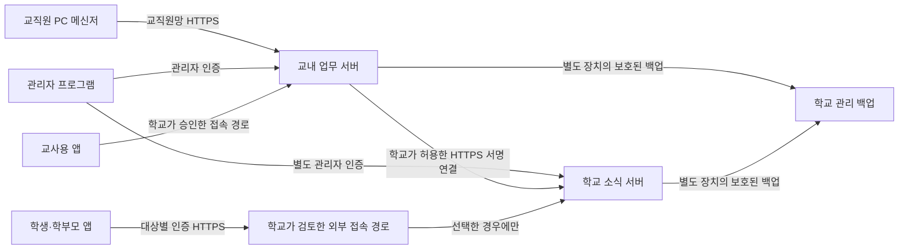

# 학교 통합 메신저 보안성 검토 제출 자료 초안

2026-10-28 · 출시 전 1.0.0 · 미확정

이 문서는 학교가 실제 사업에 맞게 작성할 작업용 자료다. 교육부 공식 서식 제2호를 작성 완료한 서류나 접수·승인 증거가 아니다. 제출기관의 최신 서식·요구 문서에 옮겨 작성하고, 자체 개발 시 제안요청서 등의 해당 여부를 확인한다. 실제 정보가 채워진 사본은 공개 저장소에 올리지 않는다. [조항·운영 통제 안내](security-regulatory-controls-2026-10-28.md)를 함께 검토한다.

## 1. 정보화사업 개요

| 항목 | 작성 내용 |
| --- | --- |
| 운영 학교·설립 구분 | [학교 입력: 학교명, 공립/사립] |
| 사업명·목적 | 학교 통합 메신저 도입 / 교직원 업무 연락과 대상별 학교 소식 전달 |
| 실제 이용 범위 | [교직원 PC 메신저, 교사용 앱, 학생·학부모용 앱 중 사용할 범위와 기능] |
| 교육활동·행정업무 구분 | [기능별 구분 및 판단 근거. 교직원 업무를 자동으로 교육활동 예외로 분류하지 않음] |
| 운영·보안·개인정보 책임 주체 | [학교가 지정. 개발자와 구분] |
| 개발·유지보수 | 개발 연락 김동욱 / yd043105@gmail.com. 실제 계약·지원 범위는 [학교 확인] |
| 시범 대상·기간·예산 | [인원·대상 학년·예산·일정] |
| 검토 의뢰 기관·결정 | [관할기관, 담당 창구, 접수/결정 번호, 범위, 날짜. 생략 판단이면 구체적인 근거와 책임 주체] |

## 2. 사업계획서

1. 가상 계정으로 서버·PC 두 대·Android·iPhone 연결을 시험한다. 실제 학생 자료를 개발 도구나 공개 GitHub에 넣지 않는다.
2. 계정 명부·담임/분반·보호자 관계·업무 담당 권한을 학교가 대조한다. 최초 교직원 계정은 활성화와 개인 비밀번호 설정을 거친다.
3. 기능별로 메시지·파일 제출·제한 공지·시간표·상담·특별실·수강신청의 대상과 담당자를 정한다. 교육과정 수강신청은 현재 요구에 따라 학년별, 1·2학년 대상, 정원 제한 없이 운영한다.
4. 학교 정책·동의 안내·권리 행사·학생 졸업 파기·학부모 마지막 재학 자녀 기준을 확정한다. 초안 동의가 실제 운영 확정으로 바뀌지 않도록 한다.
5. 외부 접속과 외부 사업자를 선정하기 전에 데이터 분류·저장/관리 위치·계약·국외 처리·인증 고려·사고 대응을 검토한다. Cloudflare나 개인 Gmail의 적합성을 개발자가 확정한 것으로 기록하지 않는다.
6. 망 분리·HTTPS·운영 계정·OS 접근 권한·디스크/백업 암호화·백신·업데이트·UPS·장애 통보를 학교에서 확인한다. 현재 확인하지 않은 장비를 설치 완료로 쓰지 않는다.
7. 별도 장치에서 DB·첨부·키·검토 기록을 복원하고 접근권한·졸업 파기를 대조한다. 복원 직후 일반 이용을 재개하기 전에 기존 복원 검토 절차를 수행한다.
8. 소수 대상 시범 후 학교가 운영 전환을 결정한다. 중단 시 대체 안내·연락 수단, 자료 반환/파기, 운영 종료·유지보수 책임을 정한다.

## 3. 요구사항·제안요청 대응 초안

| 요구사항 | 현재 구현 근거 | 학교의 인수 확인 |
| --- | --- | --- |
| 관리자·교직원·학생·학부모 권한 분리 | 서버 API의 관리자/업무 담당/대상별 권한 검사 | 다른 역할과 학급의 자료 접근 거부 |
| 계정 보안 | 개별 계정, 초기 활성화·비밀번호 변경, 실패 제한, 세션 회수 | 퇴직·전학·분실·역할 변경 처리 |
| 서버 간 연결 | HTTPS, 요청 본문 서명·시각·중복 난수 검사 | 실제 키 보관·회전·시계·학교 간 혼선 차단 |
| 공지·제출 대상 | 학년·학급·분반·담임과 확인된 자녀 관계 | 비대상 계정·다른 보호자의 URL 직접 접근 거부 |
| 첨부 | 허용 형식·크기·무결성·권한·검사·30일 만료 | 실제 백신 검사와 만료 후 사본/백업 처리 |
| 학생·학부모 공지 이미지 | JPG/PNG, 한 장 200,000바이트, 공지 최대 5장 | 본문 표시·화질·비대상 열람 차단. 화면 표시를 복사 방지 보장으로 설명하지 않음 |
| 오류 메일 | 신고 원문을 메일에 넣지 않는 최소 정보 전달, 수신처 검토 | 개인 이메일 사용 승인·보유/위탁/국외 처리 검토, 실제 수신 시험 |
| 백업·복원 | DB/첨부 검증·오프라인 복원·세션 폐기·파기 재적용 | 별도 암호화 장치·복원 시험·키 복구 |
| 배포 | Windows 설치 마법사, 역할 선택, 실행 중 교체 차단 | 학교 보안 제품·코드 서명·업데이트 절차·모바일 배포 서명 |
| 검토 변경 관리 | 증빙 해시·기한·역할·수신 주소·외부 송신처 대조 | 실제 승인 문서와 변경 이력의 확인 |

위 표는 요구 정의 초안이다. 실제 입찰·계약·인수 기준, 성능 수치, 유지보수 약속은 학교가 별도 확정한다.

## 4. 정보통신망 구성·데이터 흐름

논리적 역할도이며 두 프로세스·두 폴더를 보안 망 분리로 인정한 그림이 아니다. Windows 한 대에 둘 경우 VM/망/계정/저장소 분리 가능성과 사양·운영 책임을 확인한다. 분리 증거가 없으면 준비 완료로 표시하지 않는다. 외부에서 교내 업무 서버로의 포트 개방이나 무검토 터널 연결을 추가하지 않는다.

| 흐름/위치 | 실제 값을 채울 내용 |
| --- | --- |
| 교직원망·업무 서버 | [호스트, IP/CIDR, 포트, OS/계정, 장치·물리 위치, 저장 폴더, 허용 방화벽 규칙] |
| 학교 소식 서버 | [별도 호스트/VM 여부, 원본 바인딩, 공개 도메인, 역할별 데이터/키 폴더] |
| 교사용 앱 외부 접속 | [허용 방식·승인 근거·인증·내부 업무자료 외부 제공 범위] |
| 선택한 중계 | [상품·사업자·TLS 종료 지점·접속 로그·관리자·처리 국가·보안검토] |
| 메일 | [SMTP·발신 계정·수신처·처리 지역·전달 항목·보유/삭제·승인 근거] |
| 인증·로그·백업 | [각 위치/국가/관리 주체, 백업 장치, 암호화·복구 책임, 외부 관제/사고조사 협조] |
| 외부 부가 기능 | [실제 NEIS·알림·스토어 등 사용 여부와 전송 정보. 미구현 기능은 완료로 쓰지 않음] |
| 단말 간 원격지원 | [직접 연결 범위·사용자 수락·거절·종료·방화벽 허용·감사 방식] |

중계가 복호화하는 트래픽, 외부 업체의 로그·메타데이터, OS 로그·백업 사본도 흐름에 포함한다. 터널이 있다는 사실을 익명화나 인증·관제 면제 근거로 쓰지 않는다.

## 5. 자체 보안대책과 검토 결정

관리적 대책: [책임자·권한 부여/회수·변경 승인·교육·정기 점검·위탁/국외 처리·사고 접수와 대응·삭제/반환·운영 종료·대체 수단].

물리적 대책: [서버 설치 장소·출입 통제·장치 접근·매체 반출·별도 백업·UPS·정전/화재 대응·장비 폐기].

기술적 대책: [학교별 데이터 분류 및 국가 지침/N2SF 해당 통제, 망/서비스/관리 경로 분리, 최소 포트·최소 권한 계정, HTTPS와 실제 인증서 검증, 비밀키 보호, 저장장치·백업 암호화, 백신/패치, 대상별 권한, 세션 폐기, 요청 위조/재전송 방지, 파일 검사/무결성, 최소 로그·접근 통제·보유 기간, 복원 검토].

저장소의 PBKDF2·Data Protection·DPAPI·SecureStorage 사용은 DB·첨부 전체 암호화나 종단간 암호화의 인증 결과가 아니다. OS 관리자에 대한 완전한 위변조 방지, 외부 보관의 불변 감사 로그, 백신 제품과의 모든 충돌 여부, 국외 처리 적법성까지 자동 보장하지 않는다. 미확인 사항은 실제 환경 시험과 기관 검토의 잔여 조건으로 남긴다.

| 결정 항목 | 확정 내용 |
| --- | --- |
| 검토 근거·적용 범위 | [자체 서버 / 민간 클라우드 기준 / 교육현장 해당 여부와 구체적인 기능 범위] |
| 승인·조건부·보완 필요 | [실제 결정, 남은 조건, 조치 책임자·기한] |
| 증빙 문서·버전 | [개요·계획·요구·망·자체 보안·외부 사업자·인증 고려·결정 문서] |
| 보안관제·사고 협조 | [역할·연락·계약 조항·조사/자료 협조·사고 시 조치] |
| 재검토 조건 | [사업 범위/호스트/국가/상품/망/수신처/권한/위탁 변경, 학교가 정한 재확인일] |
| 검토 담당·결정권자·날짜 | [학교 작성. 개발자가 서명/승인한 것으로 만들지 않음] |

일반 오류/계정 문의처는 실제 운영 학교가 정한다. 여양고 시험 안내의 기존 문의처는 여양고등학교 교무실(061-689-5870)이며 다른 학교의 책임자로 자동 복사하지 않는다.
