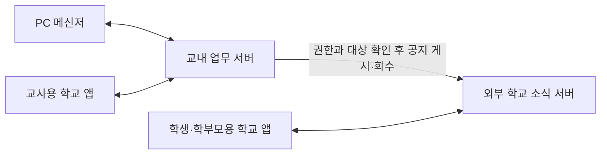

# 네이티브 화면 개선 · 2026-10-13

Windows WPF 메신저와 Android/iOS MAUI 앱을 개선한다. 앱을 웹 화면으로 대체하지 않으며 버전은 1.0.0을 유지한다.

## 적용 내용

- PC 메인 창은 기존 450×820 크기와 최소 크기, 조직도·우클릭 메뉴·메시지 동선을 유지한다. 밝은 창 장식, 여백, 둥근 표면, 은은한 색 배경으로 정리한다.
- PC 로그인 화면과 설정 메뉴의 **화면 색상 · 유리 효과**에서 색상을 바꾼다. 사용자별 설정 파일에 저장하고 다음 실행에 복원한다. 선택 색상은 열린 XAML 창의 공용 동적 리소스에도 적용한다.
- 유리 효과는 앱 자체 배경 위에 반투명 표면을 겹치는 방식이다. 바탕화면 전체를 흐리게 만드는 실시간 블러는 사용하지 않는다. 사용자가 끌 수 있고, Windows 고대비 모드에서는 시스템 색상과 선택 글자 색상을 우선한다.
- 앱 홈에 날짜·시간표 카드를 두고 교사용 일정·예약은 나란히 배치한다. 홈에서는 최근 받은 메시지 세 개를 보여 주며 메시지 탭에서 전체 받은함·보낸함·미확인함을 선택한다.
- 앱 하단 메뉴는 홈·메시지/소식·내 정보로 유지한다. 반투명 표면과 여백을 적용하며 메뉴를 펼치지 않아도 현재 위치를 확인할 수 있다.
- 시간표 조회 조건을 카드 하나에, 날짜/주 조회 버튼을 같은 행에 묶는다. 변경 수업은 별도 색으로 강조하고 변경 전 내용도 유지한다.
- 일정·예약 조회와 등록 버튼을 같은 행에 배치한다. 예약 작성의 시작/종료 날짜와 시각을 각각 한 카드에 묶고 한국 시간·24시간 형식을 표시한다. 종일 일정은 시각 입력을 비활성화한다.
- 권한, 임시 계정 제한, 약관 확인, 세션 복원과 화면 가림, 서버 분리, HTTPS, 첨부파일 보관·격리 정책은 기존 흐름을 유지한다.

| 테마 | 강조 색상 | 배경 색상 |
| --- | --- | --- |
| 여양 블루 | #245BC6 | #E7EFFB |
| 숲 그린 | #17745D | #E3F1EB |
| 라벤더 | #7050B0 | #EEE8F7 |
| 로즈 | #AD4865 | #F7E7ED |
| 슬레이트 | #506277 | #E9EDF2 |

## 확인 및 제한

Windows 네이티브 검사에는 실제 색상 선택·저장, 다섯 테마 화면 캡처, 유리 효과 해제와 잘못된 설정 복구가 포함된다. Android/iOS는 동일한 MAUI 디자인 코드와 각 플랫폼의 기본 컨트롤을 사용하므로 각각의 빌드와 네이티브 화면 검사를 수행한다. 실제 학교 계정과 개인정보 대신 로컬 가상 데이터로 검사한다.

Google 공식 `stitch-skills`의 `generate-design`과 필요한 디자인 유틸리티를 사용해 Stitch MCP로 인증하고 실제 시안을 생성·수정했다. 프로젝트와 최종 화면 ID, 시안 및 남은 제안의 한계는 [.stitch/README.md](../.stitch/README.md)에 기록한다. 브라우저 제어 도구는 시작 오류가 있었지만 공식 MCP로 연결할 수 있었다. 로컬 입력창의 근거 없는 키 형식 제한은 제거했으며, 키는 Windows DPAPI로 암호화해 Codex 설정 폴더에 저장한다. 키나 복호화 결과는 저장소에 넣지 않는다.

## 세 제품의 구성과 반영 범위

**교사용 학교 앱**, **학생·학부모용 학교 앱**, **PC 메신저**는 각각 별도 프로그램이다. 두 학교 앱은 Android/iOS 네이티브 앱이며 학생·학부모용 앱을 ‘가족용’으로 표시하지 않는다. 기존 설치 식별자와 내부 빌드 구분 값은 호환성을 위해 유지한다.

교직원 메시지·본인 시간표·학교 일정·특별실 예약은 교내 업무 서버를 이용한다. PC와 교사용 앱에서 작성한 학생·학부모 공지는 기존 대상 제한과 서버 연결을 통해 외부 학교 소식 서버로 전달한다. 학생·학부모의 시간표와 소식은 외부 서버의 권한 범위에서 조회한다. 이 UI 작업은 서버 구조, 권한 또는 외부 접속 범위를 바꾸지 않는다.

실제 프로그램에는 시안의 간결한 헤더, 메시지 상태 표시와 날짜·작성자 정렬, 메뉴 표면과 간격을 반영했다. 미확인 메시지는 API의 `readAt`을 사용한다. 메시지를 본 사람이 수신자인지 확인하고 읽음 처리를 하므로 본인이 발신자이자 수신자인 메시지도 읽음 상태가 남는다. 발신자에게만 접근 권한이 있는 메시지는 수신자 읽음 처리를 요청하지 않는다. PC 우클릭 메뉴는 현재 개인 테마를 따르며 기존 동작과 키보드 탐색을 유지한다.

Stitch가 제안한 수업 진행률·동기화 배지·재실 상태·잔여 예약 수·학생증·방과후 활동은 실제 데이터와 연결되어 있지 않아 프로그램에 추가하지 않았다. 닫힌 앱의 푸시 전달, 급식 또는 모바일 실시간 채팅도 이 시안으로 구현됐다고 표시하지 않는다. 시안의 시간표 요약은 참고용이며 실제 앱은 기존의 인증된 시간표 조회 화면으로 연결한다.

## Stitch에 전달할 디자인 요청

여양고등학교의 Windows 교사용 메신저와 Android/iOS 학교 앱을 디자인해 주세요. 사용자는 교직원, 학생, 학부모이며 기능은 이미 구현되어 있습니다. 네이티브 앱의 화면 시안이 필요합니다.

작은 Windows 메신저(450×820)는 조직도 검색, 접속 상태, 교직원 선택, 메시지/파일 보내기를 중심으로 구성합니다. 받은함·미확인·보낸함·즐겨찾기·채팅·설문·할 일/제출·학교 공지·시간표·일정/예약·설정에 접근해야 합니다. 실제 사용하는 기능을 숨기지 말고 세로 공간이 부족하면 자연스럽게 스크롤하도록 구성해 주세요.

교사용 앱 홈은 내 시간표, 학교 일정, 특별실 예약, 최근 업무 메시지와 학생/보호자 공지 작성으로 구성합니다. 학생/학부모용 앱은 자녀 선택, 학급 시간표, 대상자로 지정된 가정통신문과 공지, 자녀 연결 설정이 중심입니다. 교사용 앱과 가족용 앱의 설치·로그인은 별도로 유지합니다.

깨끗한 한국어 타이포그래피, 절제된 블루, 은은한 글래스모피즘을 사용해 주세요. 카드의 밝은 경계와 반투명 표면을 활용하되 글자를 흐리지 말고, 큰 버튼의 반복과 불필요한 빈 공간은 줄여 주세요. 설정에서 위의 다섯 색감과 유리 효과 켜기/끄기를 선택할 수 있는 화면도 제안해 주세요.

시간표의 변경 전/후 수업 구분, 일정·예약 날짜와 24시간 시각, 긴 공지 제목, 긴 한국어 이름, 빈 목록, 서버 연결 실패, 큰 글꼴, 키보드 탐색과 터치 영역을 검토해 주세요. 웹 전용 기능이나 실제로 없는 급식/닫힌 앱 푸시/모바일 채팅 버튼은 시안에 추가하지 말아 주세요.
